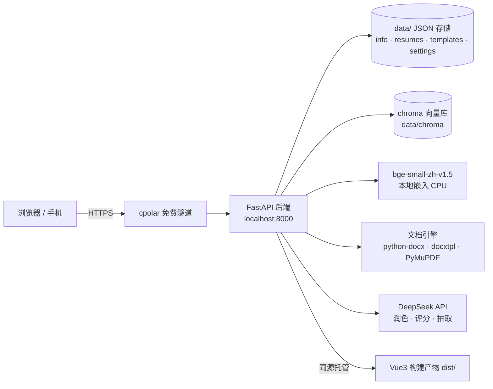

# HANDOFF · 流光简历（Resume Gallery）项目交接文档

> 用途：给**下一个 Codex 对话 / 下一个接手者**快速建立完整上下文。读完这份 + README + DEPLOY，即可直接继续开发，无需重新摸索。
> 最后更新：2026-10-15

---

## 0. 一句话
一个「类 Boss直聘 / 猎聘」的**简历工作台**：信息库 → 智能导入 → 岗位匹配生成 → 简历库语义分组；支持 AI 润色、真实 Word/PDF 模板填写、RAG 混合检索；JARVIS 全息 UI；两种形态（GitHub Pages 展示版 / 本机+内网穿透全功能版）。

## 1. 当前状态快照

| 维度 | 状态 |
|---|---|
| 功能完成度 | 阶段一（纯前端展示版）+ 阶段二（FastAPI 后端/真实模板/AI/RAG）全部完成 |
| 自动化测试 | 前端 Vitest **24** 项 · 后端 pytest **46** 项 · Playwright E2E **5** 项（全绿） |
| CI | GitHub Actions `Tests` 工作流（前端 typecheck+vitest / 后端 pytest），push 自动跑，README 徽章显示 passing |
| 类型/构建 | `vue-tsc` 通过；`npm run build`（Pages 版）与 `npm run build:backend`（后端版）均通过 |
| 线上展示版 | https://FFFMH.github.io/my-resume/ （GitHub Pages，数据存访客浏览器） |
| 全功能版 | 本机运行 `http://localhost:8000`（桌面快捷方式「流光简历·后端」） |
| 公网临时访问 | cpolar 免费隧道映射本机 8000（**地址每次重启会变**） |
| 安全加固 | API Key 掩码不回传；除 `/api/health` 外所有接口需访问口令；口令存服务端 `data/settings.json` |
| 最近提交 | `3c8e67d`（见文末列表） |

## 2. 目标与定位
- **定位**：个人单用户工具 + **面试作品/作品集**
- **首要目标**：面试官可点开、可体验、可讲清技术亮点；其次才是长期线上运营
- **非目标（明确不做）**：多用户/登录体系、招聘方功能、云原生集群

## 3. 技术架构



- **前端**：Vue 3 + TypeScript + Vite + vue-router(hash)；样式为 JARVIS 全息设计系统（CSS 变量 + 暗/亮双主题）
- **数据访问层（核心解耦）**：`src/api/types.ts` 定义 `IResumeAPI`；两个实现——`LocalStorageAdapter`（展示版，IndexedDB）与 `HttpAdapter`（后端版，fetch `/api/*`）。由 `src/api/adapter.ts` 按 `import.meta.env.VITE_BACKEND` 切换
- **后端**：FastAPI + Uvicorn，静态托管 `dist/`（hash 路由无需 SPA fallback）
- **RAG**：jieba BM25（词法）+ bge-small-zh 向量（chroma 持久化）→ **RRF 融合**；知识库 = 内置 5 份范文 + 用户历史简历（self-RAG）
- **LLM**：DeepSeek（OpenAI 兼容协议），用于 ① 润色 ② HR 评分卡 ③ 导入结构化抽取；全部有**降级兜底**（无 Key 时用规则）

## 4. 目录与关键文件

| 路径 | 作用 |
|---|---|
| `src/api/` | 前端数据层：`types.ts`（接口契约）、`adapter.ts`（切换）、`LocalStorageAdapter.ts`、`HttpAdapter.ts`、`presets.ts`（8 库定义）、`classify.ts`、`merge.ts`、`score.ts`、`similarity.ts`、`resumeTemplates.ts`（8 套 HTML 模板）、`print.ts`（打印/PDF） |
| `src/views/` | 首页 / 信息库编辑 / 导入 / 模板管理 / 生成 / 简历库 / 设置 |
| `backend/` | 后端实现（见下表） |
| `backend/knowledge/` | 内置范文 5 份（Markdown，可扩充） |
| `deploy/` | 云服务器部署配套：`setup.sh`、`resume-backend.service`、`Caddyfile.example`、`cpolar/`（本地穿透工具，**已 gitignore**） |
| `e2e/` + `playwright.config.ts` | Playwright E2E（复用本机 Edge，`webServer` 自动起后端 + 隔离数据目录） |
| `data/` | 运行时数据（**已 gitignore**）：`info/*.json`、`resumes/`、`templates/`、`chroma/`、`settings.json` |
| `DEPLOY.md` | 云服务器（Ubuntu + systemd + Caddy HTTPS）保姆级部署步骤 |
| `verify_llm.py` | 真实 Key 三链路自检：润色 / HR 评分 / 导入抽取 |

后端模块：`main.py`(应用+口令中间件+静态托管) · `routes.py`(全部 API) · `store.py`(JSON 存储) · `classify.py`(规则分类) · `import_llm.py`(LLM 抽取+置信度) · `extract.py`(docx/pdf/txt 抽文本) · `fill.py`(docxtpl + PDF 表单/多行填充) · `generate.py`(选材+评分+润色) · `embeddings.py`/`bm25.py`/`vector.py`/`retrieve.py`(RAG) · `knowledge.py`(范文库) · `docx_export.py`(内置模板导 Word) · `presets.py`(8 库字段) · `models 见 routes.py`

## 5. 快速上手命令

```bash
# CI 说明：push 到 main 会自动跑 .github/workflows/test.yml（前端 24 + 后端 46）

# 前端开发（展示版模式，数据在浏览器）
npm install && npm run dev            # http://localhost:5173

# 后端全功能版（本机）
npm run build:backend
python -m uvicorn backend.main:app --host 127.0.0.1 --port 8000   # http://localhost:8000
# 或双击 start-backend.bat / 桌面快捷方式

# 首次启用语义检索（约 100MB，走 hf-mirror）
python backend/download_model.py

# 测试
npm test                                                  # 前端 24 项
python -m pytest backend/tests -q --basetemp=.pytest-tmp   # 后端 46 项（务必带 basetemp，见"已知问题"）
npm run test:e2e                                          # E2E 5 项（需本机 Edge）

# 真实 Key 自检（需先配好 data/settings.json）
python -m backend.verify_llm

# 公网临时访问（cpolar 已解包在 deploy/cpolar/）
deploy\cpolar\app\cpolar\cpolar.exe http 8000 -config=deploy\cpolar\cpolar.yml
```

## 6. 接口契约

**前端 `IResumeAPI`（`src/api/types.ts`）**
`getSections` / `saveSection` / `addEntry` / `updateEntry` / `deleteEntry` / `importFile` / `confirmImport` / `uploadTemplate` / `getTemplates` / `deleteTemplate` / `fillTemplate` / `exportBuiltinDocx` / `generateResume` / `saveResume` / `getResumes` / `deleteResume` / `searchResumes` / `getResumeGroups` / `getSettings` / `saveSettings` / `exportData` / `importData` / `seedDemo` / `clearAll`

**后端路由（`backend/routes.py`，前缀 `/api`）**
`GET /health`（免口令）· `GET /info/sections` · `PUT /info/{id}` · `POST|PUT|DELETE /info/{id}/entries[/{eid}]` · `POST /import` · `POST /import/confirm` · `POST|GET /templates` · `DELETE /templates/{id}` · `POST /templates/{id}/fill` · `POST /export/docx` · `POST /generate` · `POST|GET|DELETE /resumes[/{id}]` · `POST /resumes/groups` · `POST /search` · `GET|PUT /settings` · `GET /data/export` · `POST /data/import` · `DELETE /data` · `POST /demo`

**数据模型要点**：`SectionData{id,name,icon,desc,single,fields[],entries[]}`；`ResumeRecord{id,title,targetJob,style,styleName,html,text,createdAt,score?,suggestions?,data?}`；`ImportPreview{fileName,sections,warnings,confidence?}`

## 7. 数据与存储
- 全部在 `data/`：`info/<sectionId>.json`（含字段定义与条目）、`resumes/index.json`、`templates/index.json + files/`、`chroma/chroma.sqlite3`（向量）、`settings.json`（LLM 配置 + 访问口令）
- 迁移/备份：设置页「导出/导入 JSON」；云端部署时 `tar` 打包 `data/` 即可

## 8. 安全模型（重要）
- **API Key**：`GET /api/settings` 只回传掩码（如 `sk-****fc6d`）；PUT 传回掩码值表示"保持不变"，传空字符串表示清空
- **访问口令**：`data/settings.json` 的 `accessToken`（或环境变量 `RESUME_ACCESS_TOKEN`，优先级更高）非空时，除 `/api/health` 外所有 `/api/*` 都要求 `X-Access-Token` 头；前端 401 时弹窗让用户输入，存 localStorage
- **凭证位置**：真实 Key 与口令**只存在于本机 `data/settings.json`**（已 gitignore）。**任何文档/代码/提交中都不得写入真实凭证**，一律用占位符

## 9. 已完成功能（编年）
1. 纯前端展示版（Vue3+TS+适配器模式，IndexedDB，部署 GitHub Pages）
2. JARVIS 全息 UI + 暗/亮双主题 + 一键体验 + 打印/PDF + 简历库搜索 + 5 模板 + 岗位评分
3. 3 套新模板（极客/深海/白纸，共 8 套）+ 导入识别增强 + 移动端优化
4. 阶段二后端：FastAPI + JSON 存储 + 真实 docx/pdf 解析 + docxtpl 填写 + DeepSeek 润色 + HTTP 适配器接入
5. RAG：BM25 + bge 向量 + RRF 融合，语义搜索/分组/选材 + 范文库 self-RAG
6. LLM 工程化：few-shot + 四层指令 + 结构化输出 + 重试降级；HR 评分卡与规则分 4:6 融合
7. 导入 LLM 结构化抽取 + 置信度分级（前端高亮低置信度）
8. PDF 表单字段填充 + 多行区域自适应
9. PWA（manifest + SW + 图标）+ 内置模板导 Word + Playwright E2E
10. 真实 DeepSeek Key 验证通过（`verify_llm.py`）+ prompt 抑制推断/重复
11. 公网暴露前安全加固（Key 掩码 + 访问口令 + 持久化）→ cpolar 隧道验证通过

## 10. 已知问题与待办（下一个对话请优先阅读）
| 类型 | 说明 | 建议 |
|---|---|---|
| 环境 | pytest 默认 tmp 目录曾被**提权运行**污染，导致 `PermissionError` | 统一用 `--basetemp=.pytest-tmp`；必要时清理 `%TEMP%\pytest-of-QQ` |
| 环境 | `.pytest_cache` 权限异常 | 用 `-p no:cacheprovider` 绕过 |
| 部署 | **免费隧道地址每次重启会变**、进程可能被回收 | 面试前 5 分钟重启并自测；或改用云服务器（DEPLOY.md） |
| 仓库 | 历史提交 `56e2fd0` 误含 cpolar 二进制（~19MB） | 如需精简可重写历史（filter-repo + 强推），注意影响协作者 |
| 产品 | 单用户无登录、数据存本机 | 若要多人用：加账号体系 + 数据库（见下） |
| 产品 | 免费隧道带宽有限、非 7×24 | 上云（Oracle 免费 ARM / 轻量服务器） |
| 测试 | E2E 依赖本机 Edge（`channel: 'msedge'`） | CI 中应改为 `npx playwright install chromium` |
| 待补（作品集向） | LICENSE、README 架构图/截图/GIF、面试话术包（CI + 徽章已完成） | 见"下一步建议" |

## 11. 给下一个对话的接手指引
1. **先读**：本文件 → `README.md` → `DEPLOY.md`（三步即可掌握全貌）
2. **改代码前**：跑一遍 `npm test` + `python -m pytest backend/tests -q --basetemp=.pytest-tmp`，确认基线是 24 / 46 全绿
3. **改前端数据层**：只动 `src/api/*`，不要把逻辑写进组件；接口签名改动必须同步 `types.ts` 的两个实现
4. **改后端**：路由在 `routes.py`，业务在各自模块；新增依赖写进 `backend/requirements.txt`
5. **提交约定**：中文 commit message，格式 `feat|fix|chore|docs: 说明`；推送前跑测试（SSH-443 通道已配好，`git push` 即可）
6. **不要提交**：`data/`、`node_modules/`、`dist/`、`.e2e-data/`、`deploy/cpolar/`、真实凭证
7. **验证习惯**：涉及 LLM/检索的改动，用 `python -m backend.verify_llm` 或 E2E 复测；涉及 UI 的改动，跑 `npm run test:e2e`
8. **若继续公网演示**：先确认 `data/settings.json` 的 `accessToken` 非空（保护生效），再起隧道

## 12. 最近提交
```
1dc69e9 ci: 新增测试工作流(前端typecheck+vitest / 后端pytest) + 测试依赖清单 + README徽章
178b62c chore: 清理调试日志文件
06c196a docs: 新增项目交接文档 HANDOFF.md（给下一个对话/接手者）
3c8e67d chore: 忽略 pytest 工作区临时目录
6b93f77 security: 访问口令持久化到服务端配置(任何启动方式均受保护) + health 状态修正
d16f6a2 chore: 移除误提交的第三方二进制与部署包（改为本地保留+忽略）
56e2fd0 security: 公网暴露前加固(Key掩码不回传 + RESUME_ACCESS_TOKEN访问口令 + 健康检查接口)
cfb504e feat: DeepSeek真实Key验证通过 + prompt抑制推断/重复 + 导入手机号归一化 + verify_llm脚本
1f72e14 feat: PWA(manifest+SW+图标) + 内置模板导Word + Playwright E2E(5用例)
a542d45 feat: 导入LLM结构化抽取+置信度分级 + PDF表单字段/多行区域填充
fa5eb9a feat: LLM润色prompt升级(few-shot+四层指令+结构化输出+重试) + HR评分卡融合(规则4:LLM6)
```