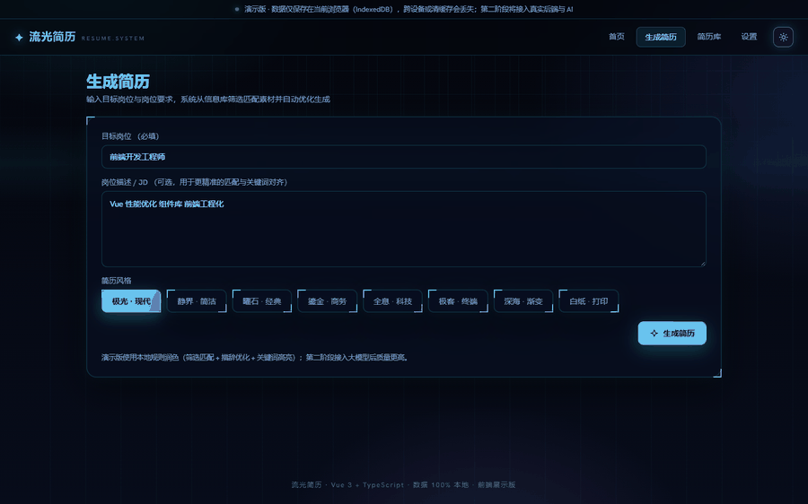
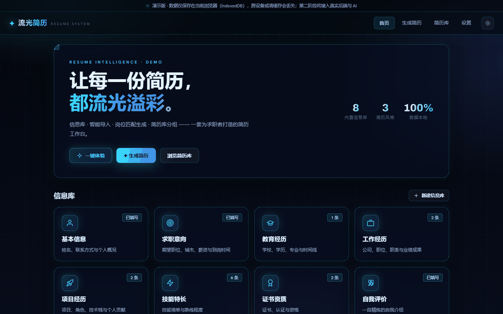
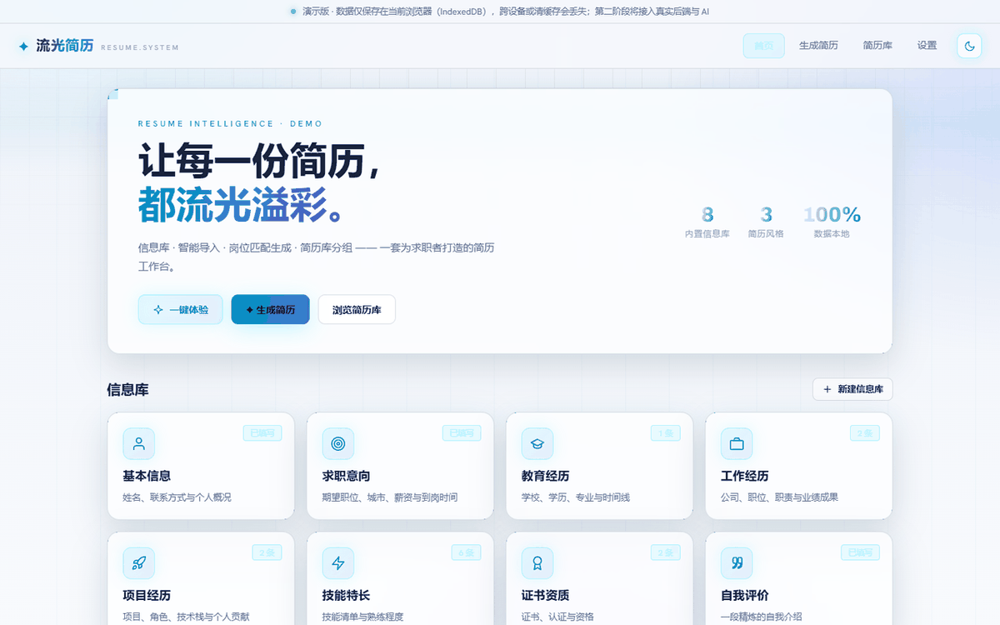
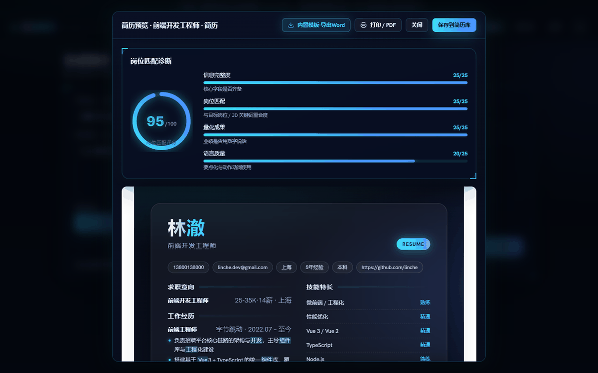
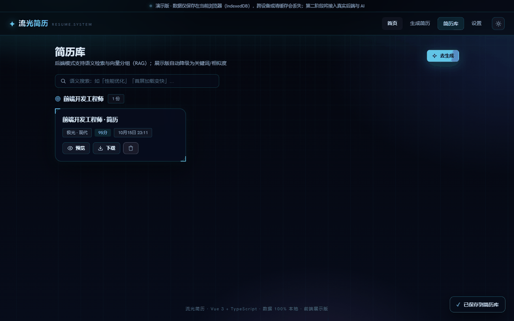
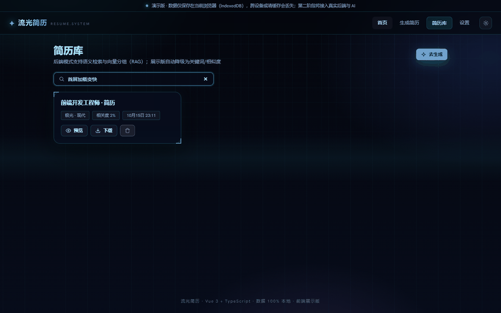
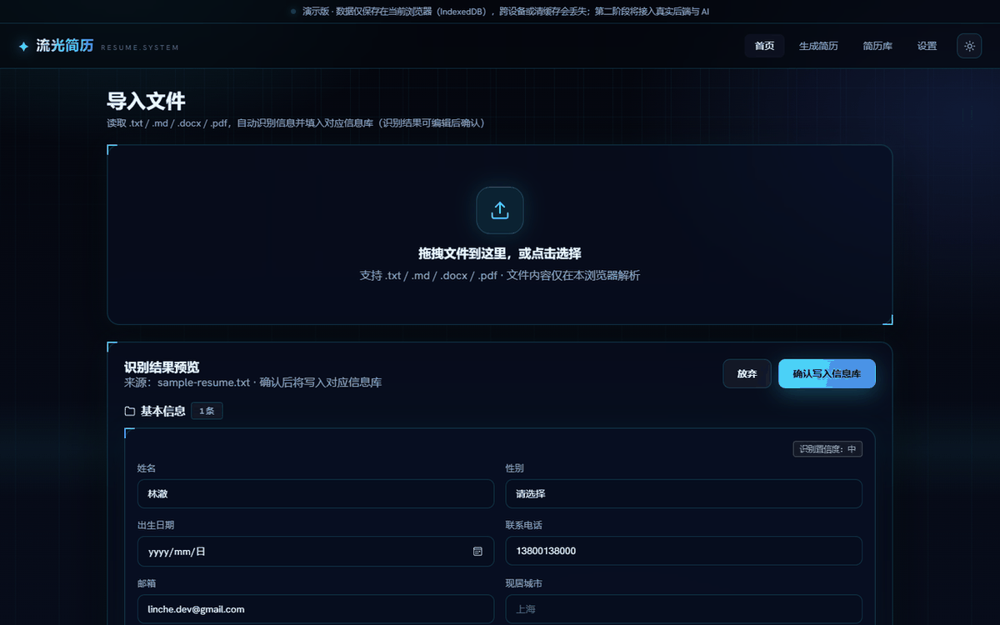
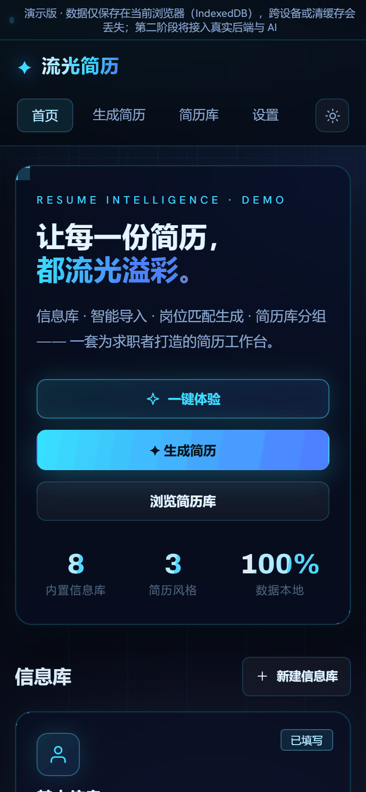
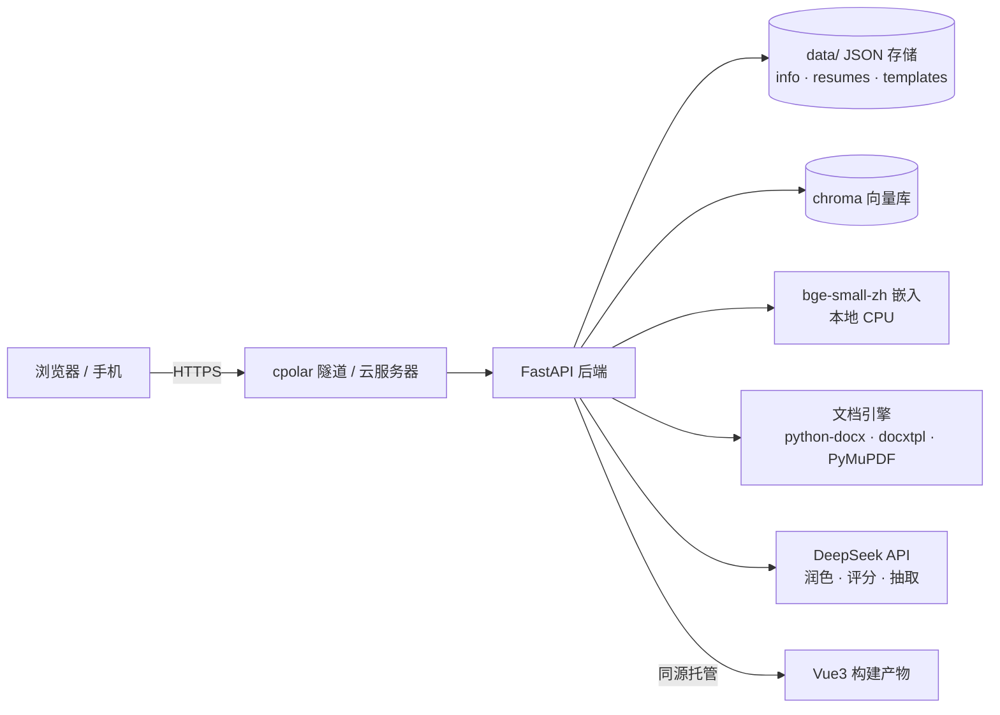

# 流光简历 · Resume Gallery

[](https://github.com/FFFMH/my-resume/actions/workflows/test.yml)
[](https://github.com/FFFMH/my-resume/actions/workflows/deploy.yml)


> 🌐 云服务器长期部署（域名 + HTTPS）请见 [DEPLOY.md](DEPLOY.md)
> 🔄 项目交接/接手说明（给下一个对话或同事）请见 [HANDOFF.md](HANDOFF.md)

一个类 Boss直聘/猎聘 风格的**简历工作台**：信息库 → 智能导入 → 岗位匹配生成 → 简历库语义分组，覆盖从素材积累到成品导出的完整闭环。

**JARVIS 全息 HUD 界面**（暗/亮双主题）· **RAG 混合检索**（BM25 + 向量 + RRF 融合）· **大模型润色与 HR 评分卡** · **真实 Word/PDF 模板保真填写** · 8 套内置简历风格 · PWA 可安装。

两种形态并存：**在线展示版**（GitHub Pages，数据存访客浏览器）+ **本机全功能版**（FastAPI 后端，含 AI / RAG / 模板导出）。

## 演示



| 首页（JARVIS 暗色） | 亮色主题 |
|---|---|
|  |  |

| 生成简历 + 岗位匹配评分 | 简历库（语义分组） |
|---|---|
|  |  |

| 语义搜索（「首屏加载变快」命中性能优化） | 导入识别 + 置信度分级 |
|---|---|
|  |  |

<p align="center"></p>

## 架构



**技术亮点**

| 亮点 | 说明 |
|---|---|
| 适配器模式零侵入升级 | `IResumeAPI` + `LocalStorageAdapter` / `HttpAdapter`，一行切换即从展示版升级为全功能版 |
| RAG 混合检索 | jieba BM25（词法）+ bge 向量（语义）→ RRF 融合；口语化查询（"首屏加载变快"）能命中"性能优化" |
| self-RAG 范文库 | 内置 5 份岗位范文 + 自动索引用户历史简历，润色时优先参考个人风格 |
| LLM 工程化 | few-shot + 四层指令（事实→措辞→量化→关键词）+ 结构化 JSON 输出 + 重试降级 + 防虚构约束 |
| 评分融合 | 规则四维评分与 HR 评分卡按 4:6 融合，输出维度分与可执行建议 |
| 文档保真 | docxtpl 占位符/循环填写 Word；PyMuPDF 填充 PDF 表单域 + 多行区域自适应 |
| 公网安全 | API Key 只回传掩码；除健康检查外所有接口需访问口令（服务端持久化） |
| 质量体系 | 前端 24 + 后端 46 + E2E 5 测试，GitHub Actions CI 自动执行 |

## 功能

| 模块 | 说明 |
|---|---|
| 信息库 | 8 个内置库 + 自定义信息库，增删改即存即用；首页「一键体验」可填充完整示例数据 |
| 导入文件 | 读取本地文件，真实抽取文本（txt/md 直读、docx 用 mammoth、pdf 用 pdfjs）；识别覆盖更多小节别名（教育背景/专业技能/项目经验等）、带空格手机号、多种日期格式（2021.7-至今）、出生日期、期望城市，可编辑后确认 |
| 模板管理 | 上传 Word/PDF 模板并识别 `{{占位符}}`；后端模式支持真实填写（docxtpl / PDF 表单域） |
| 生成简历 | 输入目标岗位 + 可选 JD → 匹配筛选 → 规则润色 → 8 套内置模板（极光/静界/曜石/鎏金/全息/极客/深海/白纸）渲染预览 → **岗位匹配评分仪表 + 优化建议** → 存入简历库 |
| 简历库 | 支持关键词搜索；按目标岗位 + 内容相似度自动分组（Web Worker，不卡界面）；卡片显示评分徽章；支持预览、打印/另存为 PDF、下载 HTML、删除 |
| 设置 | AI 引擎配置（DeepSeek Key，掩码显示）、数据导出/导入、清空本地数据 |

## 本地运行

```bash
npm install        # 安装依赖（首次）
npm run dev        # 开发服务器 → http://localhost:5173
npm run build      # 生产构建 → dist/
npm run preview    # 本地预览 dist/
npm test      # 运行单元测试（24 项）
npm run typecheck  # TS 类型检查
```

Windows 也可直接双击 `start.bat` 启动。

## 部署到 GitHub Pages（约 3 分钟，免费 HTTPS 公网地址）

1. **注册账号**：打开 https://github.com 免费注册并登录。
2. **建仓库**：右上角 `+` → New repository → 仓库名随意（如 `resume-gallery`）→ 选 **Public** → 不要勾选 "Add a README" → Create repository。
3. **推送代码**：在本项目目录打开终端（或在 VSCode 里按 `` Ctrl+` `` 打开终端），依次执行：

   ```bash
   git init
   git add .
   git commit -m "init: 流光简历第一阶段"
   git branch -M main
   git remote add origin https://github.com/<你的用户名>/<仓库名>.git
   git push -u origin main
   ```

   首次推送会弹出浏览器登录 GitHub，按提示授权即可。
4. **开启 Pages**：仓库页面 → Settings → 左侧 Pages → Source 选 **GitHub Actions**（代码里已内置 `.github/workflows/deploy.yml`，push 会自动构建并发布）。
5. **等待 1~2 分钟**：仓库 Actions 页出现绿色对勾后，访问：

   `https://<你的用户名>.github.io/<仓库名>/`

> 提示：如果不想用命令行，也可以在仓库页面用 "Add file → Upload files" 把整个项目传上去（除 node_modules、dist），效果一样。

## 数据说明

- 第一阶段数据**只存在访客自己的浏览器**（IndexedDB），换设备或清缓存会丢失。
- 可在「设置」页导出 JSON 备份，换设备后导入恢复。

## 第二阶段升级路径（接口解耦，零侵入）

- 数据访问统一走 `src/api/adapter.ts`：`export const api = new LocalStorageAdapter()`。
- 第二阶段部署 FastAPI 后端后，仅需改为 `export const api = new HttpAdapter()`（接口签名完全一致，`HttpAdapter` 已就绪），前端组件零改动。
- 随后接入：真实 Word/PDF 解析、占位符模板填写、大模型润色与 docx/pdf 高质量导出。


## 第二阶段：真实全功能版（本机运行 + 内网穿透）

展示版（GitHub Pages）数据只存浏览器；**真实全功能版**在本机跑 FastAPI 后端，数据存本机 `data/`，支持真实 Word/PDF 模板填写与 DeepSeek 大模型润色。

### 一键启动（推荐）

双击 `start-backend.bat`（自动执行 `npm run build:backend` 并启动 `http://localhost:8000`）。

或手动：

```bash
npm run build:backend
python -m uvicorn backend.main:app --host 0.0.0.0 --port 8000
```

### 公网访问（免费内网穿透，二选一）

- **cpolar**（推荐）：安装 https://www.cpolar.com 客户端并登录 → 在项目目录运行 `cpolar http 8000` → 复制输出的 `https://xxx.cpolar.cn` 地址。
- **花生壳**：安装「花生壳」客户端 → 添加内网映射（主机 127.0.0.1、端口 8000）→ 获得公网域名。

> 免费隧道带宽有限、地址可能变化，仅适合演示；长期公网建议云服务器 + Caddy HTTPS。

### 启用 AI 润色

网站「设置」页填写：Base URL `https://api.deepseek.com`、模型 `deepseek-chat`、API Key（https://platform.deepseek.com 注册充值）。生成简历时自动调用大模型润色；未配置或调用失败会自动降级为本地规则润色。

### 真实模板填写

1. 「模板管理」上传含占位符的 Word/PDF 模板，如 `姓名：{{姓名}}`、`{{ w.position }} @ {{ w.company }}`。
2. 「生成简历」预览弹窗点「模板导出」，得到按模板填好的 `.docx` / `.pdf`（Word 用 docxtpl 版式零破坏，PDF 用 PyMuPDF 原位替换单行占位符）。

### 数据与迁移

- 数据存本机 `data/`（JSON 文件，schema 与展示版一致）；「设置」页可导出/导入 JSON 备份。
- 展示版（GitHub Pages）与后端版互不影响：构建模式由 `VITE_BACKEND` 控制（`npm run build` 为展示版，`npm run build:backend` 为后端版）。

### 向量检索（RAG，后端模式）

- **混合检索**：jieba BM25（词法）+ bge-small-zh-v1.5（稠密）→ RRF 融合排序，兼顾语义与精确关键词。
- **简历库**：语义搜索 + 语义分组（按岗位与内容向量相似度聚类）。
- **生成**：按 JD 语义筛选信息库素材（与词袋打分 6:4 融合）；润色前检索范文注入 DeepSeek prompt（真 RAG）。
- **范文知识库**：内置 5 份岗位范文（backend/knowledge/）+ 自动索引你的历史简历（self-RAG，个人范文优先）。
- **启用**：首次运行 `python backend/download_model.py`（约 100MB；HF 直连失败自动切 hf-mirror.com，网络慢可多试或挂代理）。
- **降级**：模型未下载/下载失败自动降级为词法检索，功能不中断；向量与索引存 `data/chroma/`。

### 后端测试

```bash
python -m pytest backend/tests -q   # 32 项
```

## 技术栈

Vue 3 · TypeScript · Vite · vue-router (hash) · IndexedDB · mammoth · pdfjs-dist · Vitest · GitHub Actions

## 目录

```
src/
  api/        # 数据层：IResumeAPI 接口 + 适配器（Local/Http）+ 解析/分类/生成/分组
  views/      # 页面：首页/信息库/导入/模板/生成/简历库/设置
  components/ # 通用组件：玻璃卡片/图标/弹窗/骨架屏/标签输入等
  styles/     # 深色科技·JARVIS 全息 HUD（移动端已做细节优化：触摸反馈、表单 16px 防缩放、弹窗全宽、按钮全宽）设计系统
.github/workflows/deploy.yml   # GitHub Pages 自动部署
```